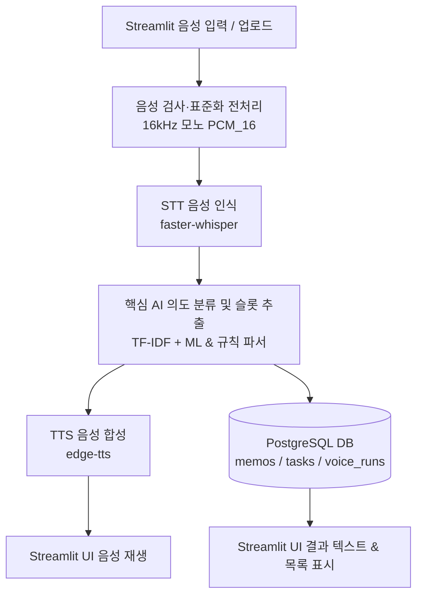

# 시스템 아키텍처 및 화면 설계서 V1

## 1. 전체 데이터 흐름

---

## 2. 모듈 인터페이스
| 모듈 | 파일명 | 함수명 | 입력 | 반환 | 예외 처리 |
|---|---|---|---|---|---|
| audio | `src/audio.py` | `preprocess_audio_bytes` `validate_wav` | WAV 바이트 (`bytes`) | 표준화 WAV 바이트, 메타데이터 dict | `ValueError` `wave.Error` |
| stt | `src/stt.py` | `transcribe_audio` `load_stt_model` | 16kHz WAV 바이너리/파일 | 전사 텍스트 (`str`), 소요시간 (`float`) | `RuntimeError` 모델 로드 실패 |
| core | `src/core.py` | `predict_intent` `extract_slots` | STT 전사 문장 (`str`) | 의도 (`Intent`), 슬롯 딕셔너리 (`dict`) | `KeyError` 미식별 의도 기본값 처리 |
| tts | `src/tts.py` | `synthesize_speech` | 음성 합성용 텍스트 (`str`) | MP3 바이트 (`bytes`), MIME 타입 | `Exception` 실패 시 톤 비프음 대체 |
| db | `src/db.py` | `add_memo` `add_task` `list_tasks` `add_voice_runs` | 각 기능별 파라미터 (내용, 마감일 등) | 생성 UUID (`UUID`) 또는 목록 (`list[dict]`) | `psycopg.Error` 연결 타임아웃 |

---

## 3. 화면별 명세
| 화면 ID | 화면명 | 주요 위젯 | 이벤트 | 성공/실패 표시 |
|---|---|---|---|---|
| UI-01 | 메인 입력 | - `st.audio_input` (마이크 녹음) - `st.file_uploader` (WAV 업로드) - `st.text_input` (텍스트 직접 입력/수정) - `st.button` (명령 실행) | 음성 제출 또는 텍스트 입력 후 실행 | - `st.spinner` 처리 중 표시 - 성공: 결과 카드 전환 - 실패: `st.error` 안내 메시지 |
| UI-02 | 실행 결과 | - `st.write` (인식된 문장 & 실행 안내문) - 의도/슬롯 태그 배지 - `st.audio` (TTS 응답 음성 플레이어) - `st.metric` (처리 소요시간 ms) | 결과 음성 자동/수동 재생 | - 성공: 초록색 성공 알림 및 피드백 음성 재생 - 실패: 재시도 가이드 표시 |
| UI-03 | 메모/할 일 목록 | - `st.tabs` (할 일 탭 / 메모 탭) - `st.dataframe` (할 일 및 메모 테이블) - 완료 체크박스 및 삭제 버튼 | 탭 전환 할 일 완료 체크 삭제 요청 | - 상태 변경 즉시 DB 반영 및 화면 갱신 - 토스트 알림(`st.toast`) 피드백 |
| UI-04 | 실행 이력 | - `voice_runs` 이력 테이블 (`st.dataframe`) - 처리 소요시간 단계별 차트 (`st.bar_chart`) | 새로고침 상세 이력 확인 | - 최근 10~20건 실행 메타데이터 시각화 |

---

## 4. 데이터 흐름·보안
- **음성 원본 저장 정책**: 
  - **기본 미저장 (개인정보 보호 원칙)**: 사용자의 실제 음성 파일은 서버 디스크에 영구 보관하지 않음.
  - 전처리 및 STT 추론 완료 후 메모리/임시 파일에서 즉시 파기.
  - `voice_runs` 이력에는 음성 원본 대신 **SHA-256 해시값(`audio_sha256`)**만 기록하여 중복 확인 및 무결성 추적.
- **API 키 및 환경변수**:
  - `DATABASE_URL` 등 민감 정보는 루트 `.env` 파일에 격리 보관.
  - `.gitignore`에 등록하여 GitHub 저장소 노출을 원천 차단.
- **사용자 식별 방식 및 접근통제**:
  - MVP 단계는 단일 사용자(로컬 데모 계정) 기준 운영.
  - 향후 다중 사용자 확장 시 `session_id` 또는 JWT 토큰을 기반으로 데이터 격리 설계.
- **에러 및 로깅 정책**:
  - 모든 음성 명령 실행 시 성공/실패 여부와 관계없이 `voice_runs` 테이블에 기록:
    - `transcript`: 인식된 텍스트
    - `intent`: 분류된 의도
    - `status`: `success`, `fail`, `need_confirm`
    - `latency_ms`: 전체 소요시간
    - `error_message`: 오류 발생 시 예외 메시지

---

## 5. 배포 구조 및 장애 대체 경로
- **UI 배포**:
  - 로컬 환경: `streamlit run app.py` (시연 및 검증 기준).
  - 클라우드 배포 (선택): Streamlit Community Cloud 또는 Render Web Service.
- **STT/TTS 추론 위치**:
  - STT: 애플리케이션 내장 `faster-whisper` (CPU/GPU 로컬 추론, 외부 API 의존 없음).
  - TTS: `edge-tts` (비동기 경량 통신) 활용.
- **DB 위치**:
  - 로컬 PostgreSQL (포트 5432) 기본 연동.
  - 클라우드 배포 시 Supabase 또는 Render PostgreSQL 인스턴스 연동.
- **배포 실패 시 로컬 시연 절차**:
  1. 가상환경 활성화 및 `pip install -r requirements.txt` 확인.
  2. `.env` 파일의 PostgreSQL 접속 정보 확인.
  3. `python src/db.py` 실행하여 테이블 자동 생성 및 접속 검증.
  4. `streamlit run app.py` 실행 후 브라우저(http://localhost:8501)에서 사전 준비된 `data/ready/*.wav` 또는 마이크로 즉시 시연.
