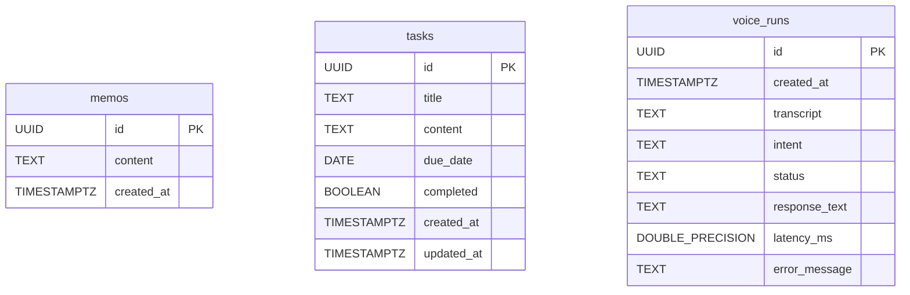

# 데이터베이스 설계서 V1

## 1. ERD

> MVP는 단일 사용자(데모 계정) 기준이므로 테이블 간 외래키(FK) 관계는 없습니다. `voice_runs`는 음성 처리 이력을 독립적으로 기록합니다.

## 2. 테이블 정의
| 테이블 | 컬럼 | PostgreSQL 타입 | PK/FK/UNIQUE | NULL 허용 | 설명 |
|---|---|---|---|---|---|
| memos | id | UUID | PK | N | 메모 고유 ID (기본값: gen_random_uuid()) |
| memos | content | TEXT | | N | 메모 내용 |
| memos | created_at | TIMESTAMPTZ | | N | 메모 생성 시각 (기본값: NOW()) |
| tasks | id | UUID | PK | N | 할 일 고유 ID (기본값: gen_random_uuid()) |
| tasks | title | TEXT | | N | 할 일 제목 |
| tasks | content | TEXT | | Y | 할 일 상세 내용 |
| tasks | due_date | DATE | | Y | 마감일 (오늘/내일 등) |
| tasks | completed | BOOLEAN | | N | 완료 여부 (기본값: FALSE) |
| tasks | created_at | TIMESTAMPTZ | | N | 생성 시각 (기본값: NOW()) |
| tasks | updated_at | TIMESTAMPTZ | | Y | 수정 시각 (기본값: NOW()) |
| voice_runs | id | UUID | PK | N | 이력 고유 ID (기본값: gen_random_uuid()) |
| voice_runs | created_at | TIMESTAMPTZ | | N | 요청 시각 (기본값: NOW()) |
| voice_runs | transcript | TEXT | | Y | STT 전사 텍스트 |
| voice_runs | intent | TEXT | | Y | 예측된 명령 의도 (ADD_TASK, LIST_TASK, UPDATE_TASK, COMPLETE_TASK, DELETE_TASK, ADD_MEMO, LIST_MEMO, DELETE_MEMO 등) |
| voice_runs | status | TEXT | | N | 처리 상태 (success, fail, need_confirm) |
| voice_runs | response_text | TEXT | | Y | 응답 문장 (TTS 재생 텍스트) |
| voice_runs | latency_ms | DOUBLE PRECISION | | Y | 처리 소요 시간 (밀리초) |
| voice_runs | error_message | TEXT | | Y | 오류 발생 시 에러 메시지 |

## 3. SQL 구현
- 스키마 파일: `sql/schema.sql`
- 초기 데이터: `sql/seed.sql` (필요 시)
- 쿼리 파라미터 바인딩 적용: 적용 완료 — 모든 SQL 쿼리를 `sql/*.sql` 파일로 독립 분리하고, psycopg `%s` 플레이스홀더를 바인딩하여 SQL Injection을 방지함.

## 4. CRUD 및 테스트
| 동작 | SQL 또는 함수 | 기대 결과 | 실제 결과 |
|---|---|---|---|
| Create | [ ] | 1건 삽입 | [ ] |
| Read | [ ] | 조회 성공 | [ ] |
| Update | [ ] | 수정 성공 | [ ] |
| Delete | [ ] | 삭제 성공 | [ ] |

## 5. 개인정보 보관·삭제 정책
- 음성 원본 파일은 DB 및 GitHub 저장소에 보관하지 않으며, STT 전사 텍스트만 DB에 저장합니다.
- DB 연결 정보(`DATABASE_URL`)는 `.env` 환경변수로 격리하여 공개 저장소 노출을 방지합니다.
- 저장된 메모와 할 일은 사용자가 웹 화면에서 직접 확인 후 개별 삭제할 수 있습니다.
- 처리 이력(`voice_runs`)은 성능 분석 및 오류 개선 목적으로 프로젝트 기간 동안만 보관하며, 평가 종료 후 일괄 파기합니다.
