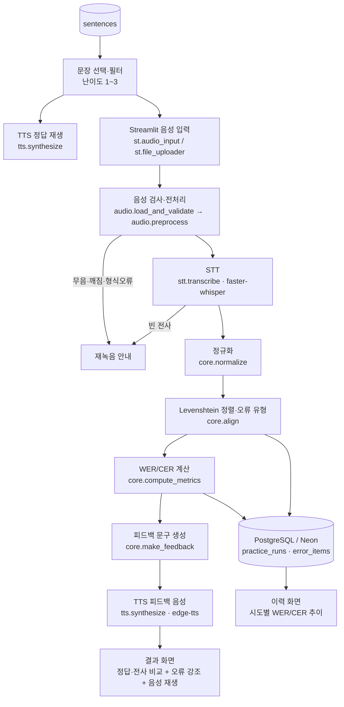

# 시스템 아키텍처 및 화면 설계서

> **프로젝트:** AI 발음 교정 및 말하기 코치 (2팀)
> **핵심 지표:** 전사 일치도(WER/CER). CER를 백점 만점으로 하여 산출함.
                 실제 발음 정확도를 판정하지 않음.
> **버전:** v0.5 (MVP 통합 기준) / 작성일: 2026-10-22

---

## 1. 전체 데이터 흐름



**처리 단계별 시간 측정:** `audio_ms`, `stt_ms`, `core_ms`, `tts_ms`, `total_ms`를 측정하여 결과 화면 하단에 표시하고 `practice_runs.latency_ms`에 총 시간을 저장.

---

## 2. 모듈 인터페이스

| 모듈 | 파일명 | 함수명 | 입력 | 반환 | 예외 처리 |
|---|---|---|---|---|---|
| audio | `src/audio.py` | `load_and_validate(file)` | WAV 바이트 / UploadedFile | `(y: np.ndarray, sr: int)` | 미지원 형식·헤더 손상 → `AudioError("형식")`; 0.5초 미만 → `AudioError("너무 짧음")`; 30초 초과 → `AudioError("너무 김")` |
| audio | `src/audio.py` | `preprocess(y, sr)` | 파형·SR | `(y_mono_16k, 16000)` | 스테레오→모노, 16kHz 리샘플링; RMS 임계값 미만 → `AudioError("무음")` |
| stt | `src/stt.py` | `transcribe(y, sr)` | 16kHz 모노 파형 | `{"text": str, "stt_ms": int}` | 모델 로드 실패 → `STTError` (`@st.cache_resource`로 1회 로드); 빈 문자열 → `status="empty_transcript"` 반환 |
| core | `src/core.py` | `normalize(text)` | 문자열 | 정규화 문자열 | 정답·전사 동일 적용 (아래 2-1 정책) |
| core | `src/core.py` | `align(ref, hyp, unit)` | 정답·전사, `unit="word"/"char"` | `list[ErrorItem]` (type, ref_token, hyp_token, position) | 빈 전사 → 전체 삭제(D) 처리 |
| core | `src/core.py` | `compute_metrics(ref, hyp)` | 정답·전사 | `{"wer", "cer", "S", "D", "I", "N"}` | N=0 → `None` 반환 + `status="empty_reference"`; 100% 초과 값 자르지 않음 |
| core | `src/core.py` | `make_feedback(errors)` | `list[ErrorItem]` | 피드백 문장 str | 오류 0건 → "정답과 일치하게 전사되었습니다" |
| tts | `src/tts.py` | `synthesize(text, voice)` | 정답문/피드백문 | `bytes` (MP3) | 네트워크 오류 → 1회 재시도 후 `None`; UI는 텍스트 피드백 유지 + 재시도 버튼 |
| db | `src/db.py` | `save_run(session_id, sentence_id, transcript, metrics, latency_ms, status, errors)` | 결과 dict | `run_id: UUID` | 접속 실패 → `None` 반환, `st.session_state` 임시 보관 + 경고 표시 (앱 중단 금지) |
| db | `src/db.py` | `get_history(session_id, sentence_id=None)` | 세션·문장 ID | `pd.DataFrame` | 실패 시 빈 DataFrame + 안내 |
| db | `src/db.py` | `list_sentences(level=None)` | 난이도 | `pd.DataFrame` | 실패 시 `data/sentences.csv` 로컬 폴백 |

### 2-1. 정규화·토큰화 정책 (정답·전사 공통 적용)

| 항목 | 정책 |
|---|---|
| 공백 | 양끝 공백 제거, 연속 공백 → 1칸 |
| 문장부호 | `. , ? ! ~ … " '` 제거 |
| 숫자 | 변환하지 않음 (“3개” ≠ “세 개”는 대체 오류로 집계, 보고서에 한계로 명시) |
| WER 단위 | **공백 기준 어절** |
| CER 단위 | **공백 제외 문자** (음절 단위) |
| 점수 | **CER를 백점만점으로 산출함** (음절 단위) |
| 공식 | `(S + D + I) / N`, N = 정답 토큰 수 |

### 2-2. 공통 데이터 구조


---

## 3. 화면별 명세

| 화면 ID | 화면명 | 주요 위젯 | 이벤트 | 성공/실패 표시 |

---

## 4. 데이터 흐름·보안

- **음성 원본 저장 정책:** **기본 미저장.** 업로드/녹음 파일은 메모리에서만 처리하고 처리 직후 폐기. DB에는 전사문·지표·오류 항목만 저장. 평가용 녹음(30건)은 참여자 서면 동의 후 팀 내부 저장소(로컬/비공개 드라이브)에만 보관, **프로젝트 종료 후 30일 내 삭제**, 삭제 요청 시 즉시 삭제. Git에는 `.gitignore`로 모든 오디오 차단.
- **API 키:** `.env`(로컬) / Streamlit Cloud `secrets.toml`(배포). `DATABASE_URL`, `STT_MODEL` 등 `.env.example`로 키 이름만 공유. 코드 하드코딩 금지.
- **사용자 식별 방식 및 접근통제:** 로그인 없음. 첫 접속 시 `uuid4` 익명 `session_id` 생성(`st.session_state`), 이력은 해당 세션 ID로만 조회. **인증이 없으므로 개인별 비공개 이력은 보장하지 않음**을 화면 하단·README에 고지. 개인정보(이름·연락처) 미수집. SQL은 전부 파라미터 바인딩(`%s`)으로 인젝션 방지.
- **에러 및 로깅 정책:**
  - 사용자 화면: 원인 + 다음 행동만 표시 (스택트레이스 비노출)
  - 서버 로그: Python `logging`, 레벨 INFO/ERROR, 처리시간·오류 유형만 기록 (**전사문·음성 미기록**)
  - DB: `practice_runs.status` = `ok` / `silent` / `invalid_audio` / `empty_transcript` / `tts_failed` / `db_failed`로 장애 집계

---

## 5. 배포 구조 및 장애 대체 경로

```

