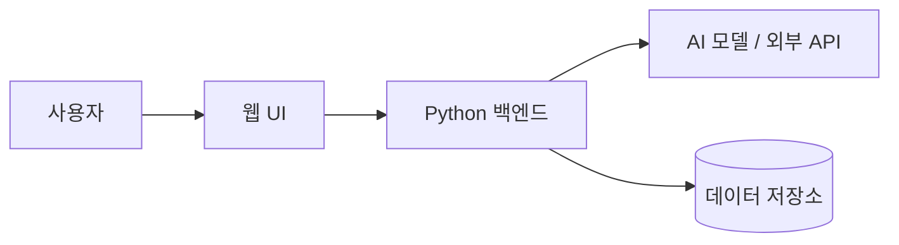

# 시스템 아키텍처 설계서

## 1. 시스템 구성 요약
- 사용자: 
- 클라이언트(UI): 
- 백엔드/API: 
- AI 모델/외부 API: 
- 데이터 저장소: 
- 배포 환경: 

## 2. 전체 아키텍처(실제 구조에 맞게 수정)

## 3. 핵심 요청 처리 흐름
1. 사용자 입력: 
2. 서버 검증 및 전처리: 
3. AI 추론 또는 API 호출: 
4. 결과 저장(필요한 경우): 
5. 사용자 응답: 

## 4. 주요 인터페이스
| 기능 ID | 메서드/함수 | 입력 | 출력 | 오류 처리 |
|---|---|---|---|---|
| F-001 | | | | |

## 5. 비기능 요구사항
- 인증 및 권한: 
- API 키 관리(.env 사용, Git 커밋 금지): 
- 개인정보 및 로그 처리: 
- 성능·가용성·비용 제한: 

## 6. 변경 이력
| 날짜 | 변경 내용 | 담당자 |
|---|---|---|
