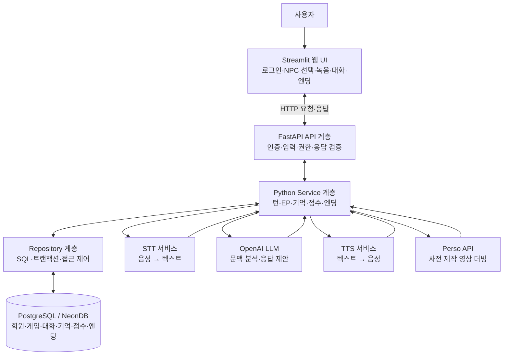

# 시스템 아키텍처 설계서

> 프로젝트: AI 음성 대화형 연애 시뮬레이션 (가칭) / 작성일: 2026-11-24 / 버전: v0.1 (팀 검토용 설계안)
>
> 기준: AI 연애 시뮬레이션 기능정의서 v2, 2026-11-24 회의 메모, 기능정의서 98개 항목, 역할별 WBS. 아직 구현·배포가 완료된 구조를 나타내는 문서가 아님.

## 1. 시스템 구성 요약
- **사용자:** 성인 대상 플레이어. 회원가입·로그인·필수 동의·언어 및 NPC 성별/유형 선택 후 카페→산책→포차 3개 장면을 진행하고 엔딩·이어하기 이용.
- **클라이언트(UI):** Python **Streamlit**. 회원가입·이메일 인증·캐릭터 선택·녹음·STT 확인·텍스트 보조 입력·대화·장면별 배경/BGM·엔딩 화면 구성. `st.session_state`는 현재 게임 턴·임시 전체/중요 기억 등 **진행 중 상태** 보조 관리에 사용.
- **백엔드/API:** **FastAPI + Pydantic + Python** 사용안. API 계층(인증·입력·권한·응답 규격), Service 계층(게임/턴/에피소드·LLM 문맥·점수·엔딩), Repository 계층(DB 접근)으로 분리. 실제 배포 방식은 미확정.
- **AI 모델/외부 API:** 음성을 글자로 만드는 **STT**, 문맥 분석(JSON)과 NPC 대사를 생성하는 **OpenAI LLM**, NPC 음성을 만드는 **TTS**, 사전 제작 영상의 번역·더빙에 사용하는 **Perso API**. STT/TTS 세부 모델, 영상 언어 지원·비용은 검토 대상.
- **데이터 저장소:** **PostgreSQL**(NeonDB 사용안). 회원/동의, 공통 캐릭터 유형과 성별 버전, 게임/EP, 대화/점수, 전체/중요 기억, 미디어·엔딩을 저장. 정확한 테이블·컬럼은 ERD에서 확정.
- **배포 환경:** **Streamlit Community Cloud(UI 후보)**, **FastAPI 서버 실행 환경(미정)**, PostgreSQL/NeonDB, 외부 AI API. UI 호스팅과 API 호스팅의 연결 및 비밀키 관리 방식을 결정해야 함.
- **설계 원칙:** **Layered Architecture**(Presentation → API → Service → Repository/Database, Service → External Clients). 사용자에게 공개하지 않을 페르소나 내부 지침·점수 판단 근거 등은 서버에서 관리.
- **구현 전 확정 사항:** 캐릭터 4종(유형 2 × 남/여) 또는 6종(유형 3 × 남/여), 4언어 실구현 범위, 성인 인증, 저장 시점, 보안 정책, 점수/턴 경계값, API 배포 위치.

## 2. 전체 아키텍처(실제 구조에 맞게 수정)

**계층별 책임 및 연동**

| 계층/컴포넌트 | 담당 역할 | 입력·출력/연결 | 주요 기능 ID |
|---|---|---|---|
| Presentation: Streamlit | UI·프론트 | 사용자 음성·텍스트·클릭 입력, 응답·오류·배경·엔딩 표시 | AUTH, CHAR, EP, VOICE-001/003/005, END-004 |
| API: FastAPI/Pydantic | PM·API·통합 | 사용자/게임 식별과 입력 검증, Service 호출, 통일된 오류·응답 형식 | AUTH-001/002/006/007, FLOW-001 |
| Service: 대화·점수·분기 | AI·대화·점수 + PM·API·통합 | EP/기억 조회, LLM 결과 검증, 점수 가중치·턴·엔딩 판정 | AI-001~011, SCORE-001~011, EP, END |
| External Clients: STT/TTS/Perso | AI·음성·미디어 | 외부 API 호출, 타임아웃·실패 시 대체 출력 | VOICE-002/004, MEDIA-001~008 |
| Repository: DB 접근 | DB·데이터 | 사용자별 권한 검사, SQL, commit/rollback, 저장/조회 | DB-001~012, AUTH-004/005, FLOW-002 |
| Database: PostgreSQL | DB·데이터 | 계정·페르소나·게임·기억·점수·엔딩·미디어 메타데이터 | DB-001~012 |

**제안 데이터 구조(ERD 확정 전)**

| 데이터 | 역할 | 저장할 주요 값(안) |
|---|---|---|
| `users`, `user_profiles`, `user_consents` | 계정·프로필·동의 | UUID 사용자 키, 로그인 ID·이메일(중복 제한), 비밀번호 해시, 닉네임·연령·언어, 동의 유형·시각 |
| `characters`, `character_variants`, `episodes` | 공통 페르소나·성별 외형/음성·3개 시나리오 | 유형 ID, 버전 ID, 성격/가중치, 이름·이미지·음성, 에피소드 번호·목표 |
| `game_sessions`, `conversations`, `score_logs` | 진행 상태·대화·점수 이력 | game_id, user_id, EP·턴·호감/신뢰·상태, role, 메시지 내용, 점수 변화량·근거 |
| `character_memories` 및 전체/중요 기억 구조 | 대화 문맥·핵심 기억 | 사용자·캐릭터·게임 연결, 원본 턴/내용, 요약·intent, EP·시각. 별도 2테이블 구성은 확정 필요 |
| `game_endings`, `media_assets` | 엔딩 및 영상 위치 | 엔딩 코드, game_id, 캐릭터/언어, 미디어 URL·작업 ID·상태 |

**주의:** 성별 표현별 `variant_id`와 공통 페르소나 `character_type_id`를 분리한다. 성별만 다른 동일 유형은 성격·EP 목표·점수 규칙을 공유하지만 이름·이미지·TTS 음성은 다르게 조회한다. 사용자마다 `game_id`를 분리해 기록이 섞이지 않도록 한다.

## 3. 핵심 요청 처리 흐름
1. **사용자 입력:** 로그인·필수 동의·인증 후 NPC 성별/유형과 언어 선택 → EP1 시작. 이용자는 **음성 녹음 또는 텍스트**를 입력한다. 음성인 경우 STT 인식 결과를 화면에 제시하고 **확인·수정된 텍스트**를 확정 발화로 사용한다.
2. **서버 검증 및 전처리:** API가 사용자 인증, `game_id` 소유권, NPC/EP 선택값, 유효 턴 수·입력 길이·빈 발화를 검증한다. Service는 DB에서 선택 페르소나·EP 목표·최근 대화·기억·현재 점수 조회 후 `system` 규칙/`user` 발화/과거 `assistant` 메시지 등 모델 입력을 구성한다.
3. **AI 추론 또는 API 호출:** LLM이 주체·의도·태도·부정·시제·확실성·장면 목표 태그와 점수 변화량을 **구조화 결과(JSON)**로 제안한다. 검증 실패·불확실 판단은 재시도/중립 처리. Python 점수 엔진은 캐릭터 공통 규칙, 반복 보상 제한, 범위(0~100), 턴 중복 여부를 검증해 최종 수치를 결정한다. NPC 응답은 **장면/태그/관계 상태에 맞는 템플릿 우선**, 필요하면 제한적 LLM 문장 변형 후 TTS 생성. Perso 영상은 자유대화 매 턴 생성이 아닌 **사전 제작·저장된 영상**을 이벤트 시 불러온다.
4. **결과 저장(필요한 경우):** 대화·점수·진행 상태·기억의 저장 이벤트를 결정한다. 11/24 메모상 진행 중 `session_state['allmemory']`, `session_state['keymemory']` 관리, EP 해금·'다음에 하기'·마지막 단계에서 DB 저장을 논의했으나 **저장 시점은 미확정**이다. `st.session_state`만 사용하면 앱 재실행/재시작 시 데이터가 유실될 수 있으므로 DB 체크포인트·중복 요청 식별자·트랜잭션·복구 정책을 결정한다. EP 종료 시 통과 기준(임시 EP1 30/20, EP2 40/50)을 판정하고 EP3에서는 사용자/NPC 고백·수락·거절에 따라 엔딩을 기록한다.
5. **사용자 응답:** 채팅 내용·NPC 음성·현재 EP·남은 턴·다음 장면 해금·엔딩을 UI에 표시한다. 점수 상세값과 내부 분석 근거를 **사용자에게 어디까지 공개할지는 미확정**이다. 오류 발생 시 재입력·재녹음·텍스트 대체·기본 이미지 제공 등으로 안내하며 잘못된 점수를 반영하지 않는다.

**실패 시 처리 흐름(요약)**

| 상황 | 처리 기준 |
|---|---|
| 녹음 없음·침묵·STT 실패 | 재녹음 또는 텍스트 입력 안내, 해당 발화의 턴·점수 미증가 |
| LLM 지연·오류·JSON 규격 오류 | 로딩/실패 안내, 제한된 재시도 또는 중립 응답, 중복 점수 방지 |
| 판단 불확실·제3자 발화·질문 | 근거 없는 보상·감점 금지, 필요 시 확인 질문 |
| TTS·영상 오류 | NPC 텍스트 또는 대체 이미지·기본 영상 제공 |
| DB 저장 실패·중복 요청 | 트랜잭션 취소/복구, 동일 턴·점수·엔딩 중복 방지 |
| 인증 만료·다른 사용자의 game_id | 재로그인 안내 또는 접근 차단, 타인 기록 반환 금지 |

## 4. 주요 인터페이스

> URL은 기능정의서에 나온 **권장 API 경로**와 11/24 메모를 결합한 **설계안**이다. 실제 엔드포인트·메서드·요청/응답 스키마와 상태 코드는 구현 전에 확정한다.

| 기능 ID | 메서드/함수 | 입력 | 출력 | 오류 처리 |
|---|---|---|---|---|
| AUTH-001, AUTH-004~007 | `POST /auth/signup` | 아이디·이메일·비밀번호·필수 동의·인증 완료 상태 | 사용자 ID·가입 결과 | 중복 아이디/이메일, 동의·인증 누락 차단 |
| AUTH-006/007 | `POST /auth/email/send`, `POST /auth/email/verify` **(추가 설계안)** | 가입 이메일, 6자리 코드 | 발송·검증 결과 | 잘못된/만료된 번호, 전송 실패·과도한 재요청 안내 |
| AUTH-002 | `POST /auth/login` | 아이디·비밀번호 | 로그인·세션 결과 | 잘못된 자격 정보, 만료 상태 차단 |
| CHAR-001~003, CHAR-007/008 | `GET /characters`, `GET /characters/{id}` | 성별·유형/캐릭터 ID | 목록·상세·버전 정보 | 없는 ID·유형/성별 조합 거부 |
| EP-001, DB-001 | `POST /games` | 사용자 ID·유형/버전 선택 | `game_id`, EP1·점수 초기 상태 | 미인증·중복·존재하지 않는 NPC 차단 |
| DB-004, EP-009 | `GET /games/{id}` | 인증정보·game_id | 마지막 EP·턴·점수·기억 요약 | 소유권 검증, 없는 게임 ID 오류 |
| VOICE-001~003 | `POST /games/{id}/speech` **(추가 설계안)** | 음성, 언어 | STT 텍스트 | 무음·오디오 불량·STT 실패 안내 |
| FLOW-001, AI-001~009, SCORE | `POST /games/{id}/turns` | 확정 텍스트, 턴 식별자, EP | NPC 대사·점수 변화·진행 상태 | 잘못된 입력·AI 오류·중복 요청 검증 |
| EP-002, EP-006/007 | `GET /games/{id}/episodes` | game_id | 장면 정보·해금 여부 | 조건 미달·권한 없음 차단 |
| DB-002/005/006 | `GET /games/{id}/history` | 인증정보·game_id | 대화·기억 이력 | 다른 사용자/캐릭터 기록 접근 차단 |
| END-003~005/008 | `GET /games/{id}/ending` | game_id | 엔딩 코드·결과·영상 정보 | 미완료 상태·없는 엔딩 안내 |
| MEDIA-001~008 | `GET /media/events/{id}` | 이벤트·성별 버전·언어 | 해당 이미지/영상 URL·상태 | 미디어 없음/실패 시 기본 이미지 제공 |

- **역할별 인터페이스 소유:** API 계약/라우터=PM·API·통합, 프롬프트·점수=AI·대화·점수, DB 조회·저장=DB·데이터, 화면 입력·출력=UI·프론트, STT/TTS/Perso=AI·음성·미디어.
- **공통 응답 규칙(설계안):** 정상 `data` 및 오류 `error` 코드를 분리해 반환하고 UI가 로딩·재시도·권한 오류를 구분할 수 있게 한다. 상세 JSON Schema와 상태코드 표는 D3 API 명세에서 확정한다.

## 5. 비기능 요구사항
- **인증 및 권한:** 회원가입 시 이메일 6자리 인증 및 필수 동의 확인. 로그인 세션을 검증하고 사용자별 게임·대화·기억·엔딩의 소유권을 확인한다. 비밀번호는 해시 저장하고 DB 비밀정보는 반환하지 않는다. **이메일 소유 인증과 성인 확인은 별개**이므로 성인 확인 절차는 정책 확정 후 구현한다.
- **API 키 관리(.env 사용, Git 커밋 금지):** OpenAI·Perso·STT/TTS·DB 접속정보는 로컬 `.env` 또는 배포 환경 Secrets로 관리한다. `.env`를 `.gitignore`에 등록하고 GitHub에 Push하지 않는다. 사용자 브라우저에 비밀키를 노출하지 않는다.
- **개인정보 및 로그 처리:** 사용자 식별자·이메일·연령·선호 정보·대화/음성 데이터의 수집 목적·제3자 제공·보존/삭제 기준을 정의한다. 외부 STT/LLM/TTS로 전송되는 정보 범위와 동의 안내가 필요하다. 오류 로그에는 비밀번호·인증번호·API 키·원본 대화/음성 전체를 임의로 남기지 않는다.
- **성능·가용성·비용 제한:** API별 타임아웃·재시도 상한, 중복 전송 방지, 응답 지연 시 로딩 안내·텍스트 대체 경로, Perso 사전제작 영상 재사용, 비용 상한과 API 호출 로그(비밀값 제외)를 적용한다. 실제 응답 시간 목표·동시 사용자 수는 측정 후 정한다.
- **데이터 무결성:** 사용자별 기록 분리, `game_id`·`turn_id` 기반 중복 방지, 점수 0~100 보장, 저장 실패 시 `commit/rollback`, EP 해금·엔딩·기억 참조 관계 검증. 임시 `session_state`만으로 이어하기를 보장하지 않는다.
- **모델 품질·안전:** LLM JSON Schema 검증, 부정문·발화 주체·시제·질문 구분, 캐릭터/언어 일관성, 부적절한 표현 제한, 점수 근거 테스트. AI 판단은 확정된 사실이 아닌 제안으로 취급하고 Python 규칙으로 최종 반영한다.
- **배포 및 운영:** Streamlit과 FastAPI를 별도 실행할 경우 서버 주소·CORS·HTTPS·API 인증·Secrets 연결이 필요하다. Streamlit Cloud만으로 FastAPI 별도 서버가 자동 제공되는 것으로 가정하지 않는다. 장애 시 발표용 예비 영상과 오류 대응 경로를 준비한다.
- **미확정 정책 목록:** 캐릭터 수 4/6, 4개 언어 실제 적용, 인증 방법, 유효 턴 수·호감도 임계값, 원본 음성 저장 여부, allmemory/keymemory DB 저장 기준, TTS/Perso 도입 범위, 배포 서버, 점수 사용자 공개 범위.

## 6. 변경 이력
| 날짜 | 변경 내용 | 담당자 |
|---|---|---|
| 2026-11-24 | 제공된 설계서 양식에 최신 AI 연애 시뮬레이션 기능정의서·11/24 회의 메모·역할별 WBS를 반영하여 계층형 구성도, 데이터 흐름, 인터페이스 및 비기능 요구사항 작성. 불일치 사항은 미확정으로 표시 | PM·API·통합 (이름 미정) |
