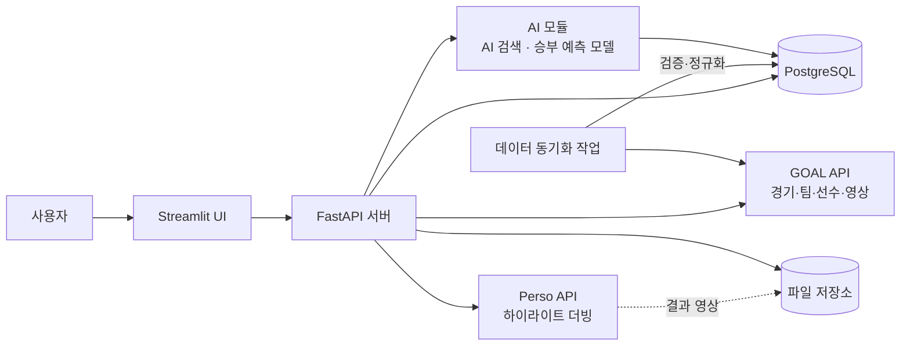

# 시스템 아키텍처 설계서

## 1. 시스템 구성 요약
- 사용자: 해외 축구(EPL) 팬. 비회원은 조회 기능을 사용하고, 회원은 응원팀 개인화·미니게임을 추가로 사용 
- 클라이언트(UI): Streamlit — 메인 홈(로그인·회원가입 버튼), 회원가입, 경기 일정/결과, 경기 상세(라인업·텍스트 중계·통계), 팀/선수, AI 검색, 승부 예측, 하이라이트 더빙,
미니게임(선택)
- 백엔드/API:  회원 인증, 조회 API, AI 검색·예측 API, 더빙 작업 관리 + 별도 데이터 동기화 작업(GOAL API → 검증/정규화 → DB)
- AI 모델/외부 API
  - GOAL API: 경기·팀·선수·이벤트·영상 메타데이터
  - AI 모듈: 질문 의도·대상 추출 및 근거 기반 답변(AI 검색), 승무패 추론 모델(LogisticRegression, RandomForest 등)
  - Perso API: 권한이 확보된 하이라이트 영상 다국어 더빙 요청·상태 확인
- 데이터 저장소: PostgreSQL(회원·응원팀·리그·팀·선수·경기·이벤트·통계·예측·하이라이트·더빙 이력·미니게임 포인트) + 파일 저장소(영상 파일, DB에는 위치·작업 정보만 저장) 
- 배포 환경: 미정 — 로컬 시연 기준으로 개발, 배포 방식은 확정 필요

## 2. 전체 아키텍처(실제 구조에 맞게 수정)

## 3. 핵심 요청 처리 흐름

### 3.1 회원가입·로그인 (F-001, F-002)
1. 사용자 입력: 메인 페이지의 회원가입/로그인 버튼 → ID·비밀번호·닉네임(가입) 또는 ID·비밀번호(로그인) 입력
2. 서버 검증 및 전처리: 입력 형식 검사, ID·닉네임 중복 확인, 비밀번호 해시 처리·검증
3. AI 추론 또는 API 호출: 해당 없음
4. 결과 저장(필요한 경우): `users`에 ID·닉네임·비밀번호 해시 저장
5. 사용자 응답: 가입/로그인 결과, 중복·오류 안내, 로그인 시 응원팀 기준 메인 홈 표시

### 3.2 경기 조회·실시간 텍스트 중계 (F-006, F-007)
1. 사용자 입력: 리그·날짜 선택 → 경기 선택
2. 서버 검증 및 전처리: 리그·날짜·경기 ID 유효성 확인, 내부 ID ↔ GOAL API ID 매핑
3. AI 추론 또는 API 호출: 동기화 작업이 GOAL API에서 경기 상태·이벤트·라인업·통계를 주기적으로 조회(호출 제한 고려)
4. 결과 저장(필요한 경우): `matches`, `match_events`, `match_stats`에 중복 없이 저장(upsert)
5. 사용자 응답: 스코어·상태·이벤트 타임라인·선발 라인업 표시(포메이션 표시가 어려우면 텍스트로 대체), 주기적 갱신

### 3.3 AI 검색·챗봇 (F-008)
1. 사용자 입력: 자연어 질문
2. 서버 검증 및 전처리: 질문 길이·빈 값 검사, 의도와 대상(팀/선수/경기) 추출
3. AI 추론 또는 API 호출: 저장 데이터 우선 조회, 없으면 GOAL API 조회 → 조회 결과를 근거로 답변 생성
4. 결과 저장(필요한 경우): 필요 시 질문·답변 로그 저장(개인정보 제외)
5. 사용자 응답: 근거 데이터와 함께 답변, 범위 밖이거나 자료가 없으면 명확히 안내

### 3.4 AI 승부 예측 (F-009)
1. 사용자 입력: 예정 경기 선택
2. 서버 검증 및 전처리: 경기 시작 전인지 확인, 경기 시작 전 확보 가능한 과거 기록만 집계해 특징 생성(경기 후 정보 사용 금지)
3. AI 추론 또는 API 호출: 학습된 모델로 홈승/무/원정승 추론
4. 결과 저장(필요한 경우): `predictions`에 경기 ID·모델 버전·예측 결과·예측 시각 저장
5. 사용자 응답: 홈승/무/원정승 예측 결과 표시

### 3.5 하이라이트 더빙 (F-010)
1. 사용자 입력: 팀·경기 결과 화면의 하이라이트 선택 → 더빙 언어 선택
2. 서버 검증 및 전처리: 하이라이트 원본 파일 접근 가능 여부·이용 권한(`rights_status`) 확인
3. AI 추론 또는 API 호출: Perso API에 더빙 요청 → 작업 ID 수신 → 처리 상태 조회
4. 결과 저장(필요한 경우): `dubbing_jobs`에 작업 ID·언어·상태·결과 위치 저장, 영상은 파일 저장소에 보관
5. 사용자 응답: 처리 상태 표시, 완료 시 더빙 영상 재생(권한이 없으면 통계·경기 요약 대안 영상 사용)

## 4. 주요 인터페이스
| 기능 ID | 메서드/함수 | 입력 | 출력 | 오류 처리 |
|---|---|---|---|---|
| F-001 | `POST /auth/register` | ID, 비밀번호, 닉네임 | 가입 결과 | 중복 ID·닉네임 409, 형식 오류 422 |
| F-001 | `GET /auth/check-id`, `GET /auth/check-nickname` | ID 또는 닉네임 | 사용 가능 여부 | 빈 값 422 |
| F-002 | `POST /auth/login` | ID, 비밀번호 | 인증 토큰/세션 | 계정 불일치 401(존재 여부 노출 안 함) |
| F-003 | `PUT /users/me/favorite-team` | 팀 ID | 저장된 응원팀 | 비로그인 401, 없는 팀 404 |
| F-004 | `GET /leagues`, `GET /teams`, `GET /teams/{team_id}` | 리그 ID, 팀 ID | 리그·팀 목록, 팀 정보(설명·수상 기록 제공 시) | 없는 ID 404, 미제공 항목 "정보 없음" |
| F-004, F-005 | `GET /teams/{team_id}/players`, `GET /players/{player_id}` | 팀 ID, 선수 ID | 선수 목록, 프로필·시즌 기록 | 없는 ID 404, NULL과 0 구분 |
| F-006 | `GET /matches` | 리그, 날짜 | 경기 일정·결과 | 잘못된 날짜 422, 결과 없음 빈 목록 |
| F-007 | `GET /matches/live`, `GET /matches/{match_id}`, `GET /matches/{match_id}/events` | 경기 ID | 상태·스코어·라인업·이벤트 | GOAL API 실패 시 마지막 저장 데이터 + 갱신 시각 표시 |
| F-008 | `POST /ai/search` | 자연어 질문 | 답변, 근거 데이터 | 범위 밖·자료 없음 안내, AI 호출 실패 시 재시도 후 오류 메시지 |
| F-009 | `GET /ai/predictions/{match_id}` | 경기 ID | 홈승/무/원정승, 모델 버전 | 이미 시작한 경기 400, 특징 부족 시 "예측 불가" |
| F-010 | `POST /dubbing`, `GET /dubbing/{job_id}` | 하이라이트 ID, 언어 / 작업 ID | 작업 ID, 상태, 결과 영상 위치 | 권한 미확보 403, Perso 실패 시 상태 "실패" 저장·재시도 |
| F-011 | `POST /minigame/predictions`, `GET /minigame/points` | 경기 ID, 예측 결과 | 적중 여부, 적중률, 누적 포인트 | 비로그인 401, 경기 시작 후 예측 400, 중복 예측 409 |

> 경로는 우리 서비스의 내부 API 제안이며 GOAL API 실제 엔드포인트와 구분한다. 응원팀·영상 목록·미니게임 API는 요구사항 확정 후 상세화한다.

## 5. 비기능 요구사항
- 인증 및 권한: 비밀번호는 해시로만 저장, 응원팀·미니게임 기능은 로그인 사용자 본인 데이터만 접근 가능
- API 키 관리(.env 사용, Git 커밋 금지): GOAL API·Perso API·AI API 키와 DB 접속 정보는 `.env`로 관리하고 `.gitignore`에 등록, 저장소에는 `.env.example`만 커밋
- 개인정보 및 로그 처리: 저장하는 개인정보는 ID·닉네임으로 최소화, 로그에 비밀번호·토큰·API 키 기록 금지
- 성능·가용성·비용 제한: GOAL API 호출 제한에 맞춰 동기화 주기 설정 및 DB 캐싱, 외부 API 실패 시 저장 데이터로 대체 표시, Perso 더빙은 비동기 작업으로 처리, 영상 편집·더빙·재배포 권한이 확인된 영상만 사용

## 6. 변경 이력
| 날짜 | 변경 내용 | 담당자 |
|---|---|---|
| 2026-11-24 | 시스템 설계 초안 기반 최초 작성 | 최준혁 |
| 2026-11-24 | 회의 반영: 회원가입 ID·비밀번호·닉네임 분리 및 ID·닉네임 중복 확인, 회원가입 페이지 추가, 메인 로그인·회원가입 버튼, 미니게임 적중률 포인트제, 라인업 텍스트 대체, 팀 결과 화면 하이라이트 배치, 팀 설명·수상 기록 추가 |최준혁  |

